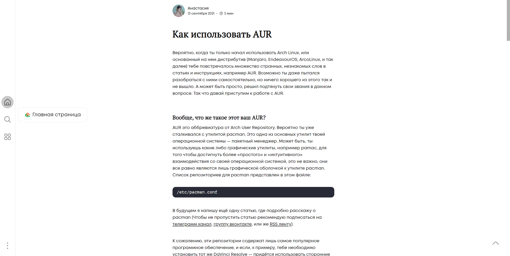

## Description

A monolithic, highly optimized, debloated (a part) WordPress theme written from scratch specifically for Asya’s sites.

### Installation

- Install: python3, git
- Open your terminal:
- git clone https://github.com/jarpex/mebbr
- cd mebbr

## Usage




### Configuration

Create a configuration file for your website like «/config/example.cfg». Configuration files should be placed at **/config/** directory. Each parameter should be placed for one line. To create a newline in your configuration file you should use a **&newline&** command. There is also available a **&tab&** command for better code legibility.

### Build

To build the project, use the command:

- python3 ./main.py arguments

Available arguments:

- config.cfg — specify your configuration file
- config — alternate version to specify configuration file
- --skip — do not upgrade theme version
- --patch — increment a patch version
- --minor — increment a minor version
- --major — increment a major version
- --help — show a help

If no launch arguments are specified for the application, the theme will be built for the site [MEBBR](https://mebbr.ru/)

If the build is successful, you will get theme files in the **/build/** directory.

Also, you should manually place static files from **/src/css/** and **/src/js/** into you CDN.

## Automation with Justfile & Deployment

For local development and server deployment, [Just](https://github.com/casey/just) is configured via `Justfile`.

### Environment Configuration (.env)

Copy `.env.example` to `.env` and set the deployment variables:

```bash
cp .env.example .env
```

Parameters in `.env`:
- `DEPLOY_SITES`: Space-separated list of sites to build and deploy (e.g. `"mebbr suckless"`). Each corresponds to `config/<site>.cfg`.
- `DEPLOY_TARGET_<site>`: Target remote path via SSH/rsync/scp in format `user@host:/path/to/wp-content/themes/<theme_name>`.
- `SSH_KEY_PATH`: Path to SSH private key (default: `~/.ssh/id_ed25519`).
- `SSH_PORT`: SSH port (default: `22`).

### Commands

```bash
# Show all available just commands
just

# Install frontend/node dependencies
just setup

# Compile SCSS styles via Gulp
just styles

# Build theme locally (default site is mebbr, bump is --skip)
just build mebbr
just build suckless --skip

# Build and deploy all sites specified in DEPLOY_SITES (increments patch version by default)
just deploy
just deploy --skip

# Build and deploy a specific site (without bumping version by default)
just deploy-one mebbr
just deploy-one suckless --patch
```

Deployment automatically uses `rsync` if available, falling back to recursive `scp` on Windows systems.
